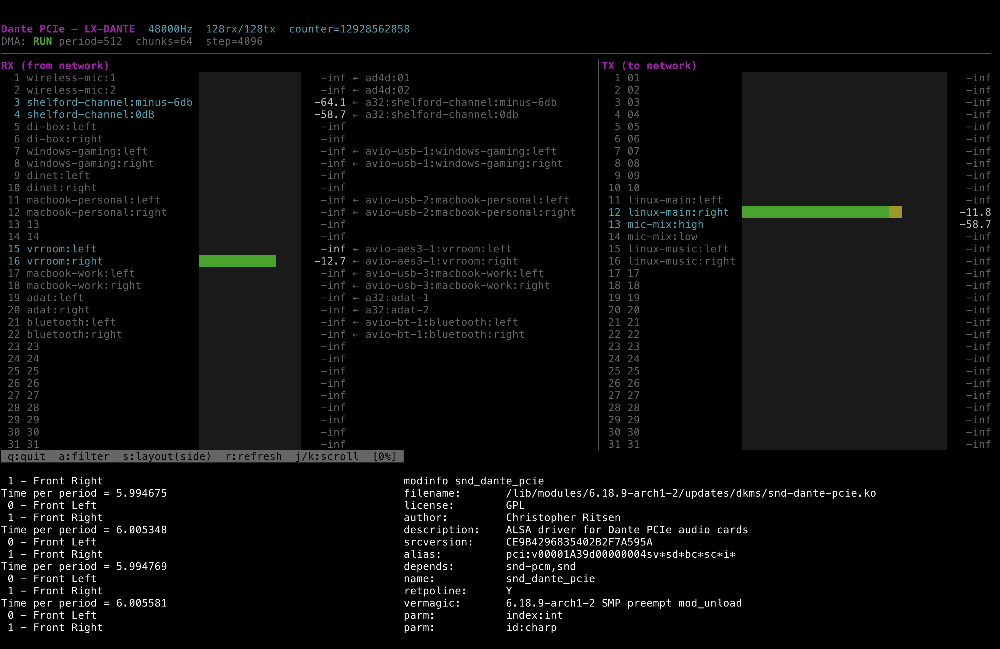

# snd-dante-pcie

Clean-room Linux ALSA kernel driver for Dante PCIe audio cards based on the Gennum GN4124 PCIe-to-local-bus bridge (PCI 0x1a39:0x0004).

Tested on:

- [Digigram LX-DANTE](https://www.digigram.com/support/discontinued-products/discontinued-sound-cards/lx-dante-support/)
- [Four Audio Astoria Dante PCI Express Card](https://www.getdante.com/product/four-audio-dante-pci-express-card/) (user-reported)



## Features

- 128 channels playback + 128 channels capture at 44.1/48/88.2/96 kHz; 64 each at 176.4/192 kHz
- MMAP non-interleaved S32_LE format
- Native JACK and PipeWire Pro Audio full duplex, with periods in 16-frame steps bounded by available DMA buffer memory
- VDMA sequencer microcode for chunk-based DMA with ring buffer wrap
- MSI interrupts allocated and configured through the Linux PCI API
- Debugfs: register access (`bar0`, `bar4`), DMA buffer access (`audio_rx`, `audio_tx`), per-channel peak meters (`meters`)
- Character device `/dev/dante-pcieN` with ioctl for card info and mmap for direct DMA buffer access

Stop all PCM streams before changing the Dante sample rate. The next PCM
open reads the current rate and channel limit from the card. Playback and
capture share a period size but can be opened, stopped, and restarted
independently. Linked duplex streams start together.

## Building

```
make
sudo insmod snd-dante-pcie.ko
```

## Installing

```
sudo make install
sudo depmod
sudo modprobe snd-dante-pcie
```

To switch between this driver and the proprietary `dante_pcie` driver:

```
# Use clean-room driver
echo "blacklist dante_pcie" | sudo tee /etc/modprobe.d/dante-select.conf

# Use proprietary driver
echo "blacklist snd_dante_pcie" | sudo tee /etc/modprobe.d/dante-select.conf

# Remove preference (first found wins)
sudo rm /etc/modprobe.d/dante-select.conf
```

## Clean Room Sources

This driver was implemented exclusively from public documentation and hardware observation. No proprietary source code was consulted.

### Gennum/Semtech Documentation (not redistributable)

These documents are marked "Proprietary & Confidential" by Gennum/Semtech and are not included in this repository. They were formerly available from gennum.com and semtech.com and may be obtainable from Semtech support or electronics document archives.

| Document | Doc Number | MD5 | Description |
|----------|-----------|-----|-------------|
| GN412x PCI Express Family Reference Manual | 52624-0, June 2009 | `3e36d6b541f9ce823407acf8990e4837` | Register map, interrupt controller, GPIO, 169 pages |
| GN4124 Datasheet | 48407-1, May 2009 | `0299def68b9a70cdf6ffb12bda552c4e` | Pinout, electrical specs, 31 pages |
| Implementing Multi-channel DMA with the GN412x IP | 53715-0, December 2009 | `f0a9fe86bc8f5eb555dc9989d354c57e` | VDMA sequencer programming, 36 pages |

### Open Source References (included)

| Source | License | Description |
|--------|---------|-------------|
| [CERN gn4124-core](https://github.com/terpstra/gn4124-core) | GPL v2 | FlexDMA sequencer instruction encoding (`vdma_seqcode.h`) |
| `docs/observed_fpga_behavior.md` | Public domain | FPGA register behavior captured from hardware observation |
| `CLEAN_ROOM_SPEC.md` | Public domain | Hardware specification derived from the above sources |

The [native JACK failure and validation record](docs/observed_fpga_behavior.md#15-native-jack-failure-and-validation-2026-10-14) preserves the original report, exact test setup, driver identities, results and remaining validation gaps.
The [real-audio validation](docs/observed_fpga_behavior.md#17-real-audio-and-sample-rates-2026-10-14) covers all six rates, channel limits, buffer configurations, and the diagnostic mapping fixes.
The [JACK and PipeWire lifecycle validation](docs/observed_fpga_behavior.md#18-independent-streams-and-linked-duplex-2026-10-15) covers independent direction changes, linked starts, repeated server sessions, and five-minute audio captures at 48 kHz.
The [Ubuntu Studio validation](docs/observed_fpga_behavior.md#19-ubuntu-studio-desktop-and-vm-audio-policy-2026-10-15) records the existing VM's package versions and its default audio buffering failure separately from controlled runs.

## dante-live.py

The included `dante-live.py` is a TUI dashboard that displays real-time audio meters, channel names, and Dante routing via `/dev/dante-pcieN`. It uses read-only mmap for zero-copy access to the DMA audio buffers. Diagnostic devices default to root-only access; run `sudo python3 dante-live.py`.

Requires: `numpy`, `curses`

Optional: [`netaudio`](https://github.com/chris-ritsen/network-audio-controller) — if installed, dante-live.py displays Dante channel names and network routing info. Without it, channels are shown by number only.

## License

This is free and unencumbered software released into the public domain. See [LICENSE](LICENSE).

Note: The kernel module itself is licensed GPL. The userspace tools and documentation are public domain.
